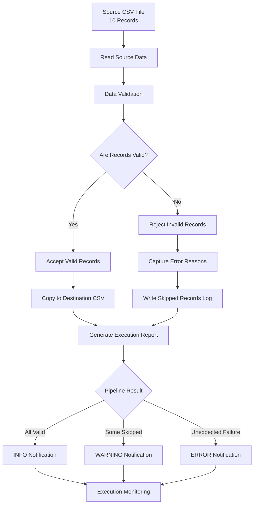
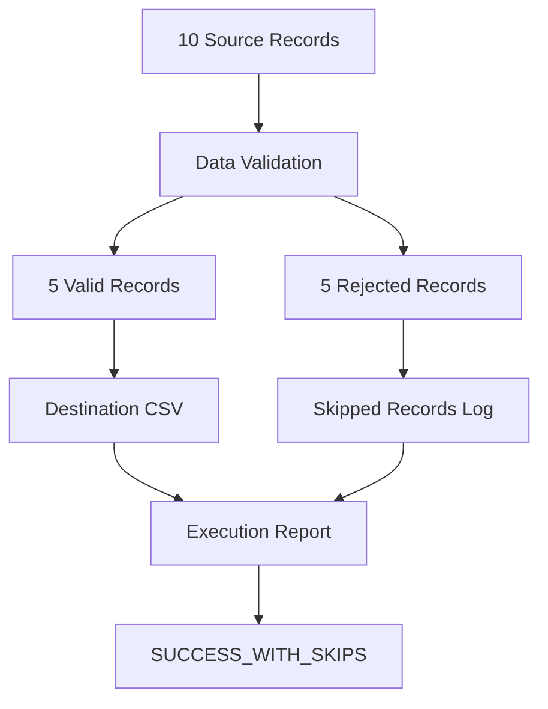
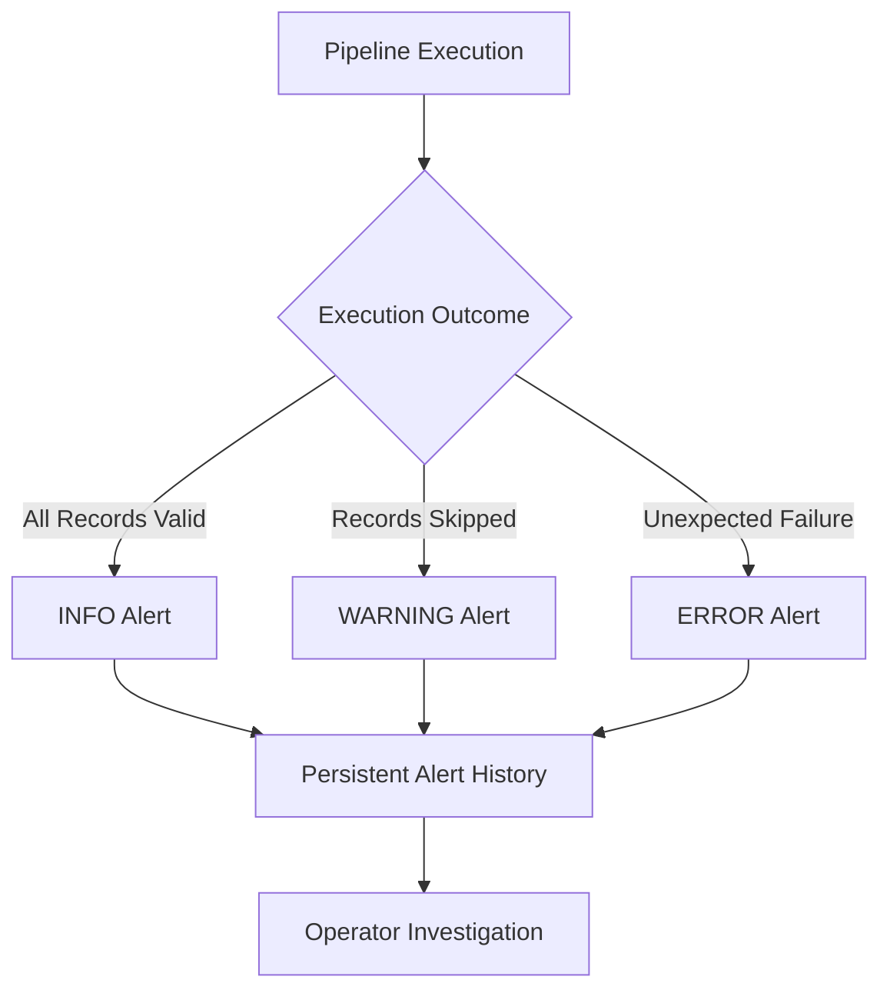

# Azure Data Factory – Fault Tolerance in Data Pipelines

## 1. Project Overview

This project demonstrates the concept of fault tolerance in data pipelines using a local Python-based implementation inspired by Azure Data Factory (ADF).

The primary objective is to understand how a data pipeline can process valid records while gracefully handling missing values, incompatible data types, and malformed records without unnecessarily terminating the entire pipeline.

In real-world data engineering environments, source datasets frequently contain incomplete, inconsistent, or corrupted information. If a pipeline stops whenever it encounters an invalid record, the entire data ingestion process can become unreliable.

Azure Data Factory provides native fault-tolerance capabilities within its Copy Activity, including options to skip supported incompatible rows and log skipped data to Azure Blob Storage.

Since Microsoft Azure was unavailable for this assignment, the required workflow was implemented locally using Python, Pandas, and Pytest.

The local implementation reproduces the core fault-tolerance pattern:

- Read records from a source CSV file.
- Validate incoming records.
- Separate valid and invalid records.
- Copy valid records into destination storage.
- Capture rejected records with their corresponding error reasons.
- Generate execution reports.
- Maintain structured execution logs.
- Trigger simulated pipeline alert notifications.
- Automatically test the pipeline using Pytest.

**Important:** This project is a local simulation of an Azure Data Factory fault-tolerance workflow. It does not create an actual Azure Data Factory instance, Azure Blob Storage container, or native ADF Copy Activity.

---

## 2. Assignment Objectives

The original hands-on assignment focuses on configuring fault tolerance in Azure Data Factory.

The objectives are:

1. Understand how data corruption affects data ingestion pipelines.
2. Create a source dataset containing missing and malformed records.
3. Implement a data-copy workflow.
4. Identify incompatible and incomplete records.
5. Skip invalid records while continuing to process valid records.
6. Maintain logs of skipped records.
7. Monitor pipeline execution.
8. Generate notifications for partial and complete failures.
9. Understand strategies for handling missing data.
10. Illustrate the technical workflow using a diagram.
11. Explain how native fault-tolerance features in ELT tools prevent unnecessary pipeline failures.

The local implementation covers these objectives through a Python-based data processing workflow.

---

## 3. Technology Stack

| Technology         | Version          | Purpose                                             |
| ------------------ | ---------------- | --------------------------------------------------- |
| Python             | 3.14.6           | Main programming language                           |
| Pandas             | 3.1.1            | CSV reading, data processing and validation         |
| NumPy              | 2.5.5            | Numerical data handling through Pandas dependencies |
| Pytest             | 9.2.0            | Automated testing                                   |
| Python Logging     | Standard Library | Execution logs and error tracking                   |
| JSON               | Standard Library | Pipeline execution reports and alert records        |
| CSV                | Standard Format  | Source, destination and rejected-record storage     |
| Visual Studio Code | Editor           | Project development                                 |
| Git                | Version Control  | Source code management                              |
| Windows 11         | Operating System | Local development environment                       |

All dependencies are installed inside a Python virtual environment.

---

## 4. Understanding Fault Tolerance

### 4.1 What is Fault Tolerance?

Fault tolerance is the ability of a system to continue operating when individual components, records, or processing operations encounter errors.

In data engineering, fault tolerance helps pipelines process reliable data even when some incoming records are incomplete, incompatible, or corrupted.

For example, consider a dataset containing 1,000 customer transactions.

Suppose:

- 950 records contain valid information.
- 30 records contain missing values.
- 20 records contain incompatible data types.

A pipeline without appropriate error handling might stop because of the invalid records.

A fault-tolerant pipeline can instead process the valid records and capture the rejected records separately.

This reduces unnecessary processing interruptions and provides visibility into data-quality problems.

### 4.2 Why is Fault Tolerance Important?

Fault tolerance is important because:

- Real-world datasets are not always clean.
- Data sources may contain incomplete records.
- Different systems may use different data formats.
- Data types may not match destination schemas.
- Individual record errors should not always terminate complete ingestion jobs.
- Rejected records must remain available for investigation.
- Pipeline operators need reliable execution monitoring.

### 4.3 Fault Tolerance in Azure Data Factory

Azure Data Factory provides fault-tolerance functionality within Copy Activity.

Important capabilities include:

**Skip incompatible rows**

Allows supported Copy Activity scenarios to skip incompatible records rather than failing the entire copy operation.

**Log skipped data**

Allows skipped-row information to be written to a configured logging location, such as Azure Blob Storage.

**Continue processing**

Valid records can continue through the copy operation while supported incompatible records are skipped.

**Pipeline monitoring**

ADF provides pipeline and activity execution information to help operators understand processing results.

**Alert notifications**

Azure Monitor alerts and Action Groups can be configured to notify operators about pipeline failures and other monitored conditions.

These capabilities help improve the reliability and observability of data ingestion workflows.

---

## 5. Understanding Missing and Incompatible Data

Missing values and incompatible values are two different data-quality problems.

### 5.1 Missing Data

Missing data occurs when an expected field does not contain a value.

Example:

| Record ID | Customer | Amount |
| --------- | -------- | -----: |
| 1         | Rahul    |   1500 |
| 2         | Priya    |   2500 |
| 3         | Amit     |   NULL |

The third record has a missing transaction amount.

### 5.2 Incompatible Data

Incompatible data occurs when a field contains a value that does not match its expected data type or format.

Example:

| Record ID | Customer | Amount |
| --------- | -------- | ------ |
| 1         | Rahul    | 1500   |
| 2         | Priya    | 2500   |
| 3         | Neha     | ABC    |

The amount column is expected to contain numeric values, but the third record contains text.

### 5.3 Invalid Records

A record is considered invalid when it violates one or more defined data-validation rules.

For this project, the following conditions are considered invalid:

- Missing record ID.
- Missing customer name.
- Missing amount.
- Non-numeric amount.
- Missing city.

The validation module identifies these problems and assigns an appropriate rejection reason to each record.

---

## 6. Strategies for Handling Missing Data

The assignment specifically requires understanding the differences between listwise deletion and imputation methods.

### 6.1 Listwise Deletion

Listwise deletion is a statistical approach in which an entire record is removed from an analysis if it contains a missing value in one or more required variables.

Example:

Original dataset:

| Customer | Amount | City      |
| -------- | -----: | --------- |
| Rahul    |   1500 | Delhi     |
| Amit     |   NULL | Panchkula |
| Priya    |   2500 | Mumbai    |

After listwise deletion:

| Customer | Amount | City   |
| -------- | -----: | ------ |
| Rahul    |   1500 | Delhi  |
| Priya    |   2500 | Mumbai |

**Advantages:**

- Simple to understand and implement.
- Produces complete observations for the selected variables.
- Does not introduce estimated replacement values.

**Disadvantages:**

- Reduces dataset size.
- May discard useful information.
- Can introduce statistical bias when missingness is not random.

Listwise deletion is not automatically the best choice for every dataset.

### 6.2 Mean Imputation

Mean imputation replaces missing numerical values with the average of the available values in the same column.

Example:

Original amounts:

1,000, 2,000, Missing, 3,000

Mean:

(1,000 + 2,000 + 3,000) / 3 = 2,000

After imputation:

1,000, 2,000, 2,000, 3,000

**Advantages:**

- Easy to implement.
- Preserves the number of records.
- Useful for simple numerical analysis.

**Disadvantages:**

- Reduces data variability.
- Can distort statistical relationships.
- Can produce misleading results when the data distribution is skewed.

### 6.3 Multiple Imputation

Multiple imputation is a statistical technique that estimates missing values by generating multiple plausible completed datasets.

Instead of filling every missing value with one fixed number, the method accounts for uncertainty by creating several possible estimates.

Example:

A missing income value could have different estimates across multiple imputed datasets:

- Dataset 1: ₹25,000
- Dataset 2: ₹28,000
- Dataset 3: ₹26,000

The datasets are analysed separately, and their results are combined using appropriate statistical methods.

**Advantages:**

- Accounts for uncertainty in missing values.
- Can preserve relationships between variables better than simple imputation.
- Often more statistically appropriate for complex missing-data problems.

**Disadvantages:**

- More computationally expensive.
- Requires statistical knowledge.
- Results depend on appropriate models and assumptions.

### 6.4 Comparison

| Feature             | Listwise Deletion         | Mean Imputation                      | Multiple Imputation                   |
| ------------------- | ------------------------- | ------------------------------------ | ------------------------------------- |
| Approach            | Remove incomplete records | Replace missing values with the mean | Generate multiple plausible estimates |
| Preserves records   | No                        | Yes                                  | Yes                                   |
| Complexity          | Low                       | Low                                  | High                                  |
| Handles uncertainty | No                        | No                                   | Yes                                   |
| Main concern        | Information loss          | Reduced variability                  | Model assumptions                     |

**Implementation note:** This project uses record rejection and logging as its operational fault-tolerance strategy. It does not perform listwise deletion as a statistical analysis procedure or implement mean or multiple imputation. Those methods are covered conceptually as required by the assignment.

---

## 7. Project Architecture

The project implements a local data-processing architecture inspired by Azure Data Factory.

### 7.1 Technical Workflow Diagram



### 7.2 Architecture Explanation

**Source CSV**

Contains the incoming customer transaction records.

**Read Source Data**

The pipeline reads the original CSV file using Pandas.

**Data Validation**

The validator checks required fields and verifies that numerical values have compatible data types.

**Decision Node**

Each record is classified as valid or invalid according to the configured rules.

**Accept Valid Records**

Valid records are passed to the destination-writing operation.

**Reject Invalid Records**

Invalid records are separated and assigned explanatory rejection reasons.

**Skipped Records Log**

Rejected records are stored separately for further investigation.

**Execution Report**

The pipeline generates a JSON report containing record counts, processing status, timestamps, and file locations.

**Alert Notifications**

The notification module simulates informational, warning, and error alerts.

**Execution Monitoring**

Persistent logs and execution reports provide visibility into pipeline behaviour.

---

## 8. Project Folder Structure

The complete project structure is:

```text
adf-fault-tolerance-assignment/
│
├── data/
│   │
│   ├── source/
│   │   └── input_data.csv
│   │
│   └── destination/
│       └── processed_data.csv
│
├── logs/
│   ├── skipped_records.csv
│   ├── pipeline.log
│   └── alerts.log
│
├── reports/
│   └── execution_report.json
│
├── src/
│   ├── __init__.py
│   ├── validator.py
│   ├── pipeline.py
│   ├── logger_config.py
│   └── notifier.py
│
├── tests/
│   ├── test_validator.py
│   └── test_pipeline.py
│
├── .gitignore
├── requirements.txt
└── README.md
```

### 8.1 Directory Explanation

| Directory/File    | Responsibility                                      |
| ----------------- | --------------------------------------------------- |
| data/             | Stores input and output datasets                    |
| data/source/      | Contains the original CSV dataset                   |
| data/destination/ | Stores successfully processed records               |
| logs/             | Contains pipeline logs, alerts and rejected records |
| reports/          | Stores pipeline execution reports                   |
| src/              | Contains application modules                        |
| tests/            | Contains automated test cases                       |
| .gitignore        | Specifies files and directories excluded from Git   |
| requirements.txt  | Lists Python dependencies                           |
| README.md         | Contains project documentation                      |

The Python virtual environment is stored in `.venv/` and excluded from version control.

---

## 9. Implementation Steps

This section explains the complete implementation process followed during the assignment.

### Step 1: Environment Setup

Created a dedicated project directory on the Windows local system.

Configured a Python virtual environment to isolate project dependencies from the global Python installation.

The development environment uses Python 3.14.6.

### Step 2: Dependency Installation

Installed the required Python libraries.

**Pandas**

Used for reading CSV files, examining missing values, validating data types, separating records, and writing processed datasets.

**Pytest**

Used for implementing and executing automated unit tests.

The dependencies were recorded in `requirements.txt`.

### Step 3: Project Folder Creation

Created separate directories for:

- Source data.
- Destination data.
- Application modules.
- Logs.
- Execution reports.
- Automated tests.

This structure separates data, application logic, monitoring information, and test functionality.

### Step 4: Sample Dataset Creation

Created a CSV dataset containing 10 customer transaction records.

The dataset includes valid records, missing customer names, missing transaction amounts, and incompatible numerical values.

The four columns are:

| Column        | Description                          |
| ------------- | ------------------------------------ |
| record_id     | Unique transaction record identifier |
| customer_name | Customer name                        |
| amount        | Transaction amount                   |
| city          | Customer city                        |

The dataset intentionally contains data-quality issues to demonstrate fault-tolerant processing.

### Step 5: Dataset Inspection

Used Pandas to inspect the dataset.

The initial validation established:

- Total records: 10.
- Total columns: 4.
- Missing customer names: 1.
- Missing amounts: 2.
- Incompatible numerical values: 2.

The dataset was confirmed to contain the expected data-quality problems.

### Step 6: Data Validation Module

Created `validator.py`.

The module checks all required columns and evaluates each record against the configured validation rules.

It separates the incoming records into two groups:

1. Valid records.
2. Rejected records.

Each rejected record receives a descriptive error reason.

Examples include:

- missing_amount
- non_numeric_amount
- missing_customer_name

The module returns both datasets without modifying the original input DataFrame.

### Step 7: Fault-Tolerant Pipeline

Created `pipeline.py`.

The main pipeline coordinates the complete processing workflow.

Its responsibilities include:

1. Reading source data.
2. Calling the validation module.
3. Separating valid and invalid records.
4. Writing valid records to the destination.
5. Logging rejected records.
6. Calculating execution statistics.
7. Generating a JSON execution report.
8. Handling unexpected execution errors.

The pipeline uses exception handling to capture unexpected failures and generate a failure report.

When individual records are rejected but the remaining processing succeeds, the pipeline reports `SUCCESS_WITH_SKIPS`.

### Step 8: Destination Storage

Valid records are written to:

`data/destination/processed_data.csv`

The destination contains only records that satisfy all configured validation rules.

For the original dataset, five valid records were copied successfully.

### Step 9: Skipped-Record Logging

Rejected records are written to:

`logs/skipped_records.csv`

The log contains the original rejected record information and its corresponding error reason.

This ensures that rejected records are not silently discarded.

The records remain available for investigation and potential correction.

### Step 10: Execution Reporting

The pipeline generates:

`reports/execution_report.json`

The report contains:

- Pipeline name.
- Execution status.
- Start timestamp.
- End timestamp.
- Total records.
- Successful records.
- Skipped records.
- Success rate.
- Source file location.
- Destination file location.
- Skipped-record log location.

For the original dataset, the execution report recorded 10 total records, 5 successful records, and 5 skipped records.

### Step 11: Structured Logging

Created `logger_config.py`.

The module configures Python's logging functionality with both file and console handlers.

The pipeline records informational messages, warnings, and unexpected errors.

Persistent execution logs are maintained in:

`logs/pipeline.log`

The logging system helps investigate processing activities and identify execution problems.

### Step 12: Alert Notification System

Created `notifier.py`.

The notification module simulates three alert scenarios:

| Alert Level | Trigger                            | Purpose                           |
| ----------- | ---------------------------------- | --------------------------------- |
| INFO        | All records processed successfully | Confirm successful execution      |
| WARNING     | Some records skipped               | Report partial processing issues  |
| ERROR       | Unexpected pipeline failure        | Report complete execution failure |

Alert history is stored in:

`logs/alerts.log`

The file uses JSON Lines format, with one JSON notification object per line.

The current dataset produces a WARNING notification because five records are rejected.

These are simulated local notifications, not actual email, SMS, or Azure Monitor notifications.

### Step 13: Automated Unit Testing

Created two test modules:

- `tests/test_validator.py`
- `tests/test_pipeline.py`

The validator tests check:

- Acceptance of valid records.
- Detection of missing values.
- Detection of incompatible numerical values.
- Handling of missing required columns.
- Preservation of the original DataFrame.
- Correct processing of the mixed dataset.

The pipeline tests check:

- Execution with rejected records.
- Execution without rejected records.
- Failure handling and error notifications.

Pipeline tests use temporary directories to isolate test output from the project's actual data and reports.

### Step 14: End-to-End Validation

Executed the complete pipeline again using the original source dataset.

Verified that:

- The source dataset contains 10 records.
- The destination contains 5 records.
- The skipped-record log contains 5 records.
- The execution report contains the expected statistics.
- The pipeline reports `SUCCESS_WITH_SKIPS`.
- A warning notification is generated.

Additional assertions verified that the number of destination and rejected records equals the original number of source records.

The end-to-end validation passed successfully.

---

## 10. Sample Dataset and Data-Quality Analysis

The original source dataset contains:

| Record ID | Customer |  Amount | City       | Condition           |
| --------: | -------- | ------: | ---------- | ------------------- |
|         1 | Rahul    |    1500 | Delhi      | Valid               |
|         2 | Priya    |    2500 | Mumbai     | Valid               |
|         3 | Amit     | Missing | Panchkula  | Missing amount      |
|         4 | Neha     |     ABC | Chandigarh | Incompatible amount |
|         5 | Karan    |    3200 | Delhi      | Valid               |
|         6 | Missing  |    1800 | Mohali     | Missing customer    |
|         7 | Simran   |    4500 | Jaipur     | Valid               |
|         8 | Arjun    |     XYZ | Delhi      | Incompatible amount |
|         9 | Rohan    |    2100 | Mumbai     | Valid               |
|        10 | Pooja    | Missing | Panchkula  | Missing amount      |

### 10.1 Data Validation Results

| Validation             | Count |
| ---------------------- | ----: |
| Total records          |    10 |
| Valid records          |     5 |
| Rejected records       |     5 |
| Missing customer names |     1 |
| Missing amounts        |     2 |
| Non-numeric amounts    |     2 |

### 10.2 Record Classification

**Accepted records:**

Record IDs: 1, 2, 5, 7 and 9.

**Rejected records:**

Record IDs: 3, 4, 6, 8 and 10.

The pipeline successfully separates these records based on the validation rules.

---

## 11. Pipeline Execution Results

The original dataset was processed successfully.

### 11.1 Execution Summary

| Metric                         |             Result |
| ------------------------------ | -----------------: |
| Total records                  |                 10 |
| Successfully processed records |                  5 |
| Skipped records                |                  5 |
| Success rate                   |                50% |
| Rejection rate                 |                50% |
| Pipeline status                | SUCCESS_WITH_SKIPS |

### 11.2 Record Processing Distribution



### 11.3 Destination Output

The destination file contains five successfully processed records:

| Record ID | Customer | Amount | City   |
| --------: | -------- | -----: | ------ |
|         1 | Rahul    |   1500 | Delhi  |
|         2 | Priya    |   2500 | Mumbai |
|         5 | Karan    |   3200 | Delhi  |
|         7 | Simran   |   4500 | Jaipur |
|         9 | Rohan    |   2100 | Mumbai |

### 11.4 Skipped Records Output

The rejected-record log contains:

| Record ID | Customer | Amount  | Error Reason          |
| --------: | -------- | ------- | --------------------- |
|         3 | Amit     | Missing | missing_amount        |
|         4 | Neha     | ABC     | non_numeric_amount    |
|         6 | Missing  | 1800    | missing_customer_name |
|         8 | Arjun    | XYZ     | non_numeric_amount    |
|        10 | Pooja    | Missing | missing_amount        |

### 11.5 Execution Status

The pipeline completed with:

`SUCCESS_WITH_SKIPS`

This status indicates that the pipeline completed its processing workflow while capturing rejected records separately.

The pipeline did not classify record-level validation failures as complete execution failures.

---

## 12. Monitoring and Alerting

Monitoring is an important part of reliable data engineering.

This project implements structured logging and simulated notifications to make pipeline execution observable.

### 12.1 Pipeline Logging

The persistent log file is:

`logs/pipeline.log`

It contains timestamps, log levels, and messages describing pipeline activities.

Example events include:

- Pipeline initialization.
- Source file reading.
- Record validation.
- Destination writing.
- Rejected-record logging.
- Warning generation.
- Execution report generation.
- Pipeline completion.

### 12.2 Alert History

The persistent alert file is:

`logs/alerts.log`

It stores notifications in JSON Lines format.

For the current dataset, the generated alert has the following characteristics:

| Attribute          | Value                                   |
| ------------------ | --------------------------------------- |
| Alert level        | WARNING                                 |
| Message            | Pipeline completed with skipped records |
| Total records      | 10                                      |
| Successful records | 5                                       |
| Skipped records    | 5                                       |
| Pipeline status    | SUCCESS_WITH_SKIPS                      |

### 12.3 Monitoring Workflow



The notification system currently simulates alert delivery by printing messages and saving notification records locally.

---

## 13. Automated Testing

Automated testing was implemented using Pytest.

The objective was to verify that the validation and processing modules behave correctly under different input and failure conditions.

### 13.1 Test Files

**test_validator.py**

Tests data-validation functionality.

**test_pipeline.py**

Tests complete pipeline execution, including successful processing, partial failures, and unexpected source-file failures.

### 13.2 Test Cases

| No. | Test Case                        | Expected Behaviour                    | Result |
| --: | -------------------------------- | ------------------------------------- | ------ |
|   1 | Valid records                    | Accept all records                    | PASSED |
|   2 | Missing values                   | Reject incomplete records             | PASSED |
|   3 | Non-numeric amount               | Reject incompatible record            | PASSED |
|   4 | Missing required column          | Raise validation error                | PASSED |
|   5 | Original DataFrame               | Remain unchanged                      | PASSED |
|   6 | Mixed dataset                    | Return 5 valid and 5 rejected records | PASSED |
|   7 | Pipeline with skipped records    | SUCCESS_WITH_SKIPS                    | PASSED |
|   8 | Pipeline without skipped records | SUCCESS                               | PASSED |
|   9 | Missing source file              | FAILED and trigger ERROR alert        | PASSED |

### 13.3 Testing Results

The automated test suite produced the following results:

| Metric           |       Result |
| ---------------- | -----------: |
| Total test cases |            9 |
| Passed           |            9 |
| Failed           |            0 |
| Test pass rate   |         100% |
| Execution time   | 1.19 seconds |

**Final testing result: 9 passed in 1.19s.**

All nine automated tests passed successfully.

### 13.4 End-to-End Validation

In addition to the nine automated tests, a separate end-to-end verification was performed.

The verification checked:

- Source record count.
- Destination record count.
- Skipped-record count.
- Execution report status.
- Successful record count.
- Rejected record count.
- Record reconciliation.

The final reconciliation was:

**10 source records = 5 destination records + 5 rejected records.**

The end-to-end validation completed successfully.

---

## 14. Mapping Local Implementation to Azure Data Factory

The local implementation follows the same general fault-tolerance pattern as the original assignment, but it uses Python rather than Azure services.

| Assignment Requirement | Local Implementation         | Azure Data Factory Equivalent                   |
| ---------------------- | ---------------------------- | ----------------------------------------------- |
| Source dataset         | input_data.csv               | Source dataset                                  |
| Pipeline               | pipeline.py                  | ADF pipeline                                    |
| Copy operation         | Pandas CSV processing        | Copy Activity                                   |
| Record validation      | validator.py                 | Data compatibility checks and validation logic  |
| Destination storage    | Local destination folder     | Azure Blob Storage container                    |
| Skipped-row handling   | Rejected records separated   | Skip incompatible rows where supported          |
| Error logging          | skipped_records.csv          | Configured skipped-data logging in Blob Storage |
| Execution monitoring   | pipeline.log and JSON report | ADF monitoring                                  |
| Alert notifications    | notifier.py                  | Azure Monitor alerts and Action Groups          |
| Automated testing      | Pytest                       | Application and pipeline testing                |

### 14.1 Important Differences

The local implementation demonstrates the concepts, but it is not identical to the Azure service.

In actual ADF:

- Copy Activity handles supported data-copy operations.
- Fault-tolerance settings control how certain incompatible rows are handled.
- Skipped-data logging can be configured with an Azure Blob Storage location.
- Pipeline and activity runs provide execution details.
- Azure Monitor can be configured for alert notifications.

In this project:

- Python performs the record validation.
- Pandas performs the data processing.
- Local folders replace cloud storage.
- Python logging provides execution monitoring.
- A local notifier simulates alert generation.

The implementation should therefore be considered an educational local simulation, not a replacement for native Azure Data Factory functionality.

---

## 15. Limitations and Future Improvements

Although the project successfully demonstrates the required fault-tolerance concepts, several improvements could make it more production-oriented.

### 15.1 Current Limitations

1. The project runs locally rather than using Azure Data Factory.
2. Source and destination storage use local CSV files.
3. Notifications are simulated rather than delivered through email or an external notification service.
4. Validation rules are configured manually.
5. Missing values are rejected rather than statistically imputed.
6. The pipeline processes a small sample dataset.
7. The pipeline does not currently implement distributed or parallel processing.
8. The execution report does not contain detailed per-record processing durations.
9. The project does not implement automatic retries or recovery from partially completed file operations.
10. The implementation does not include actual Azure Monitor integration.

### 15.2 Potential Future Improvements

| Improvement                    | Possible Technology                              |
| ------------------------------ | ------------------------------------------------ |
| Cloud-based orchestration      | Azure Data Factory                               |
| Cloud object storage           | Azure Blob Storage                               |
| Real alert notifications       | Azure Monitor and Action Groups                  |
| Automated data-quality checks  | Great Expectations                               |
| Data processing at scale       | Apache Spark                                     |
| Workflow orchestration         | Apache Airflow                                   |
| Data warehouse integration     | Azure Synapse Analytics                          |
| Advanced missing-data handling | Scikit-learn or statistical imputation libraries |
| Centralized monitoring         | Azure Monitor                                    |
| CI/CD automation               | GitHub Actions                                   |

These improvements can extend the project into a more complete data engineering workflow.

---

## 16. Key Concepts Learned

This assignment covers several important data engineering concepts.

| Concept             | Explanation                                                 |
| ------------------- | ----------------------------------------------------------- |
| Data Ingestion      | Bringing source data into a processing pipeline             |
| Data Validation     | Checking whether records satisfy defined rules              |
| Data Quality        | Measuring the completeness and correctness of data          |
| Fault Tolerance     | Continuing processing despite recoverable errors            |
| Missing Values      | Values absent from a dataset                                |
| Incompatible Data   | Values that do not match the expected format or type        |
| Listwise Deletion   | Removing incomplete observations from an analysis           |
| Mean Imputation     | Replacing missing numerical values with their mean          |
| Multiple Imputation | Generating multiple plausible estimates for missing values  |
| Data Skipping       | Excluding incompatible records from the copy operation      |
| Error Logging       | Recording processing errors and rejected records            |
| Pipeline Monitoring | Observing execution status and processing activity          |
| Alert Notifications | Informing operators about important execution events        |
| Unit Testing        | Testing individual application components                   |
| End-to-End Testing  | Verifying that all pipeline components work together        |
| Execution Reporting | Maintaining processing statistics and execution information |

---

## 17. How to Run the Project

### Prerequisites

- Windows 11 or another supported operating system.
- Python 3.14.6 or a compatible Python version.
- Visual Studio Code.
- Git.

### Environment Setup

1. Clone or download the project repository.
2. Open the project directory in Visual Studio Code.
3. Create a Python virtual environment.
4. Activate the virtual environment.
5. Install the dependencies listed in `requirements.txt`.

### Running the Pipeline

Execute the main pipeline module from the project root.

The pipeline reads the source CSV, validates the records, writes valid records to the destination, captures rejected records, generates an execution report, and triggers the appropriate simulated notification.

### Running Automated Tests

Execute the Pytest test suite from the project root.

The tests validate the record-validation module and the main pipeline under successful, partial-failure, and unexpected-failure conditions.

### Inspecting Generated Outputs

After execution, inspect:

- `data/destination/processed_data.csv`
- `logs/skipped_records.csv`
- `logs/pipeline.log`
- `logs/alerts.log`
- `reports/execution_report.json`

These files provide the processed data, rejected records, execution history, notifications, and pipeline statistics.

---

## 18. Final Assignment Summary (Approximately 200 Words)

Fault tolerance is an important capability in modern data pipelines because real-world datasets frequently contain missing, corrupted, and incompatible records. This project demonstrates how a data pipeline can continue processing valid records without unnecessarily terminating the complete operation.

A local Python implementation inspired by Azure Data Factory was developed using Pandas and Pytest. The source dataset contained 10 customer transaction records, including missing customer names, missing transaction amounts, and incompatible numerical values. A validation module identified invalid records and separated them from valid records. Five valid records were successfully copied into the destination CSV, while five rejected records were captured in a separate log with their corresponding error reasons.

The project also implemented structured logging, JSON execution reports, and simulated INFO, WARNING, and ERROR notifications. Automated testing was performed using Pytest, with all nine test cases passing successfully. End-to-end validation confirmed that all 10 source records were accounted for.

The assignment also explored three missing-data strategies: listwise deletion, mean imputation, and multiple imputation. These methods differ in how they handle incomplete observations and preserve statistical information. Finally, the project examined how native fault-tolerance capabilities in ELT tools such as Azure Data Factory can skip supported incompatible records, log processing issues, and prevent individual data errors from unnecessarily causing complete pipeline failures.

---

## 19. Conclusion

This project provided practical experience with fault-tolerant data processing and data-quality management.

The implementation demonstrated how a pipeline can distinguish between valid and invalid records, process acceptable data, capture rejected records, maintain execution logs, generate notifications, and produce execution reports.

The successful execution of all nine automated tests and the end-to-end validation confirmed that the local implementation behaves as expected for the defined scenarios.

Although the project was implemented without Microsoft Azure, it provides a practical understanding of the fundamental fault-tolerance concepts used in Azure Data Factory and other modern data engineering platforms.

The project can be extended in the future by integrating actual cloud storage, native pipeline orchestration, centralized monitoring, and automated notification services.

**Final Result:** A working local fault-tolerant data pipeline that successfully processes valid records, captures rejected records, maintains execution visibility, and demonstrates the core concepts of Azure Data Factory fault tolerance.

---

## 20. References and Learning Resources

- [Microsoft Learn – Azure Data Factory Documentation](https://learn.microsoft.com/en-us/azure/data-factory/)
- [Microsoft Learn – Copy Activity in Azure Data Factory](https://learn.microsoft.com/en-us/azure/data-factory/copy-activity-overview)
- [Microsoft Learn – Fault Tolerance in Copy Activity](https://learn.microsoft.com/en-us/azure/data-factory/copy-activity-fault-tolerance)
- [Pandas Documentation](https://pandas.pydata.org/docs/)
- [Pytest Documentation](https://docs.pytest.org/)
- [Python Logging Documentation](https://docs.python.org/3/library/logging.html)
- [Mermaid Documentation](https://mermaid.js.org/)

---

**Project:** Azure Data Factory – Fault Tolerance in Data Pipelines

**Implementation:** Local Python Simulation

**Primary Language:** Python

**Testing Framework:** Pytest

**Final Test Results:** 9 Passed, 0 Failed

**Final Pipeline Status:** SUCCESS_WITH_SKIPS
